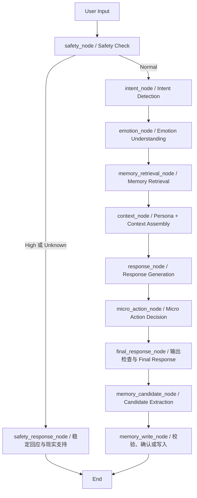

> 历史设计资料：当前服务已改为阿里云四模型接入，取消离线 Mock 和界面密钥输入，并独立处理服务错误。当前启动和配置请以项目根目录 README.md 与《接入阿里云调试说明.md》为准。

# Step 1 · AI Workflow

MOMO 是 AI 成长型陪伴宠物。核心原则是先倾听，再在用户愿意时连接现实生活；不以聊天时长、行动完成或情感依赖升级关系。

## 范围与现有设计

基于 `figma提示词.md`、当前本地原型和本次 AI Workflow 提示词。已有研究结论仅沿用此前工作簿记录，不新增访谈或研究事实。未找到独立 PRD 文件；不把原型说明视为已完成开发。

上一版 UI 仅展示告别表达安全分支。本次提示词明确要求系统级 Safety Check，因此新建系统的安全判断与情绪判断分离；不修改旧原型。`Emotion.High_Risk` 仅作为兼容字段，不能决定安全路由，也不作为诊断。

第一版是本地单用户教学 Demo：真实 LangGraph 调度、Pydantic 验证、SQLite 持久化、Streamlit UI；LLM 使用确定性的 Mock。提示词与模型协议为未来真实 LLM 预留，未接入外部模型。

## 流程

`final_response` 是状态中的用户可见答案，随后完成候选提取和写入判定，整个 `invoke()` 返回后 UI 展示。此版没有流式并行后处理。高风险与安全判断异常直接结束，跳过记忆读取、普通生成、微行动和持久化。

## Node 说明表

| Node | 输入 | 输出 | 为什么需要 | LLM：Mock / 未来 | 规则 | 失败时 |
| --- | --- | --- | --- | --- | --- | --- |
| 输入边界 | 文本、用户ID、会话上下文、显式偏好 | 新一轮 State | 验证长度，清空上一轮派生字段 | 否 / 否 | 类型、长度 | 提示输入无效，不运行图 |
| safety_node | 输入、短期上下文、未解除的安全状态 | risk_level、原因码 | 安全优先，情绪不等于风险 | 否 / 分类 | 告别与即时危险、否定/引用的有限处理 | Unknown，走安全确认分支 |
| safety_response_node | High 或 Unknown | 简短回复、冻结成长 | 不用普通陪伴替代现实支持 | 否 / 默认固定文案 | 禁止微行动和写入 | 使用本地稳定文案 |
| intent_node | 输入、显式意图 | intent、confidence | 决定倾听/整理/行动策略 | 否 / 分类 | 显式选择优先；低置信回退 Vent | Vent，confidence=0 |
| emotion_node | 输入、安全结果 | emotion、confidence | 调整回应负担，不诊断 | 否 / 分类 | 四值枚举，低置信 Neutral | Neutral，confidence=0 |
| memory_retrieval_node | 用户ID、输入 | top-3 记忆 | 保持连续性且不污染不同用户 | 否 / 否 | 用户隔离、过期过滤、词匹配+偏好 | 空列表，不伪称记得 |
| context_node | persona、短期上下文、检索结果、意图 | persona_context | 固定人格与可变策略分层 | 否 / 否 | 记忆仅作为不可信资料，限制条数 | 最小人格上下文 |
| response_node | 装配后的上下文 | draft_response | 先回应，再决定是否建议 | 否 / 生成 | 所有回复经后置检查 | 固定倾听回复 |
| micro_action_node | intent、风险、情绪、同意/拒绝 | 最多一个候选 | 只在用户有意愿时邀请行动 | 否 / 可选候选生成 | 仅 Action、Normal、未拒绝、非 Overwhelmed | 不生成行动 |
| final_response_node | draft、可选行动 | final_response | 阻止排他话术，保持单一建议 | 否 / 可选审核 | 禁用词、长度、行动数量 | 替换为安全的倾听回复；清空行动 |
| memory_candidate_node | 仅当前用户输入 | 候选列表 | 不把 AI 自己的话存成用户事实 | 否 / 结构化提取 | 上限1、明确事实、拒记优先 | 空列表 |
| memory_write_node | 候选、设置、同意ID | pending/saved/rejected | 质量、敏感性、时效、同意统一把关 | 否 / 否 | 阈值、时间、同意绑定候选ID、禁止项 | 记录错误码，不报告保存成功 |

## 条件分支

- High：稳定回应，鼓励联系现实可信任对象；必要时当地紧急支持。没有地区号码占位假数据，也不拨号。
- Unknown：直接询问当前是否安全，不继续普通生成。分类服务失败不等于安全。
- Normal：按五种 Intent 回复。显式“我只想说说”优先于模型推断。
- Action 且用户准备好：最多一个轻量行动；拒绝后本次会话不再重复邀请，用户再次明确请求才解除拒绝状态。
- 候选质量不足、过期、禁存类别、关闭记忆：拒绝写入；候选缺少确认：只放会话内 pending，不落盘。所有候选第一版均要求确认，敏感内容另需显式敏感确认。
- 确认写入走同一个 SQLite 写入校验函数，但不重跑用户文本、不重复生成回复。

## 验证与边界

无动态诊断、真实模型质量、在线安全监控、自动联系他人或自动关系升级。Mock 规则是教学样例，不能作为真实危机检测器。分类置信值为示例打分，不是校准概率。

技术依据：[LangGraph Graph API](https://docs.langchain.com/oss/python/langgraph/graph-api)。安全策略参考：[NIMH 五项支持行动](https://www.nimh.nih.gov/health/publications/5-action-steps-to-help-someone-having-thoughts-of-suicide)。提示词不能替代上线前的安全评审。
